# FitPower

A free, self-hosted fitness and home-workout tracker that runs on your own computer.
Answer a few questions, get a training plan up to your target date, and log your workouts,
weight, food and progress photos. There is no account, no login and no server: your data
stays in your browser, and the app works offline.

Built for training at home with **a pair of dumbbells and a resistance band**, plus your body weight.

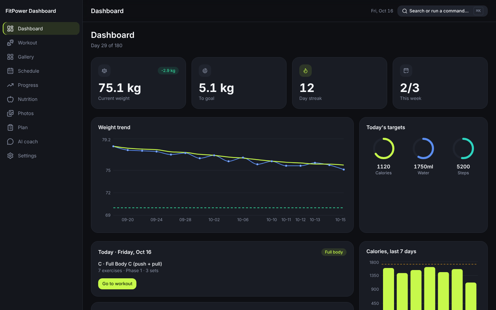

> **Health note.** FitPower gives general fitness guidance, not medical advice. Check with a
> doctor before starting a new program, especially if you have an injury or a health condition.

## Contents

- [What you get](#what-you-get)
- [Run it on your computer](#run-it-on-your-computer)
- [First run: tell it about yourself](#first-run-tell-it-about-yourself)
- [Built-in plans (no AI needed)](#built-in-plans-no-ai-needed)
- [Optional: the AI coach with your own key](#optional-the-ai-coach-with-your-own-key)
- [Daily use](#daily-use)
- [Your data, privacy and backups](#your-data-privacy-and-backups)
- [For developers](#for-developers)

## What you get

- **A plan made for you.** A short setup asks about your goal, body, experience, injuries,
  health and schedule, then builds a plan that ends on your target date.
- **Three built-in plans**, Easy, Intermediate and Hard, that work with no AI and no internet.
- **An optional AI coach.** Bring your own API key and a coach interviews you, designs the
  plan and answers questions about your progress. You can remove the key at any time.
- **A guided workout timer** with warm-up, rounds, rest and cool-down, sound cues, per-set
  logging and a "too easy / just right / too hard" rating.
- **A Workout Gallery** of 214 dumbbell, band and body-weight exercises with demo images,
  step-by-step instructions and links to video demos.
- **Tracking** for weight (with a 7-day average), body measurements, calories, protein, water,
  steps, streaks and progress photos.
- **Works offline and installs as an app** (PWA). Dark and light themes, keyboard friendly,
  and usable on a phone.

## Run it on your computer

You need **[Node.js](https://nodejs.org) 22 LTS** (or 20.19 and newer). Nothing else.

1. Download the code: **Code → Download ZIP** on GitHub and unzip it, or
   ```bash
   git clone https://github.com/saravananmadhesh/FitPower.git
   ```
2. Start it:
   - **Windows:** double-click `start-app.bat`.
   - **macOS / Linux:** run `./start-app.sh` in a terminal from the FitPower folder.
   - **Any system:** run `npm install` once, then `npm start`.
3. Open **http://localhost:5173** (the launchers open it for you).

The first start installs dependencies and takes a few minutes. After that it starts in seconds.
Leave the terminal window open while you use the app, and press `Ctrl+C` to stop it.

**Keep the address the same.** Your browser saves your data against `http://localhost:5173`
exactly. A different port, browser or device starts empty (see [backups](#your-data-privacy-and-backups)).
If port 5173 is busy, close whatever is using it rather than changing the port.

**Install it as an app (optional).** In Chrome or Edge, use the install icon in the address bar.
FitPower then opens in its own window like any other app.

## First run: tell it about yourself

The first time you open FitPower it walks you through seven short steps. Your answers stay on
your device, and you can close the tab and pick up where you left off.

| Step                | What it asks                                                                            |
| ------------------- | --------------------------------------------------------------------------------------- |
| About you           | Name, date of birth, sex (for the calorie formula)                                      |
| Your body           | Height, current weight, goal weight                                                     |
| Your goal           | Lose fat, build muscle, get fitter or maintain, and a target date (12 weeks to 2 years) |
| Experience          | Beginner, intermediate or advanced                                                      |
| Injuries and health | Knee, back, shoulder, wrist or other injuries, plus a standard health screen (PAR-Q)    |
| Lifestyle           | How you rate your diet and health, how many days a week you can train, and for how long |
| Your plan           | Pick Easy, Intermediate or Hard, or design it with the AI coach                         |

<p>
  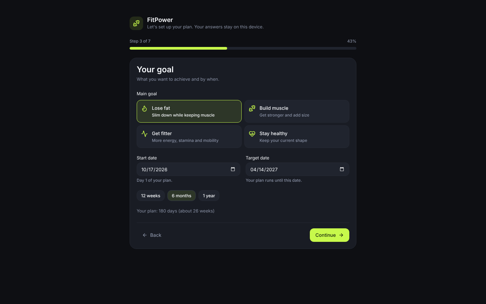
  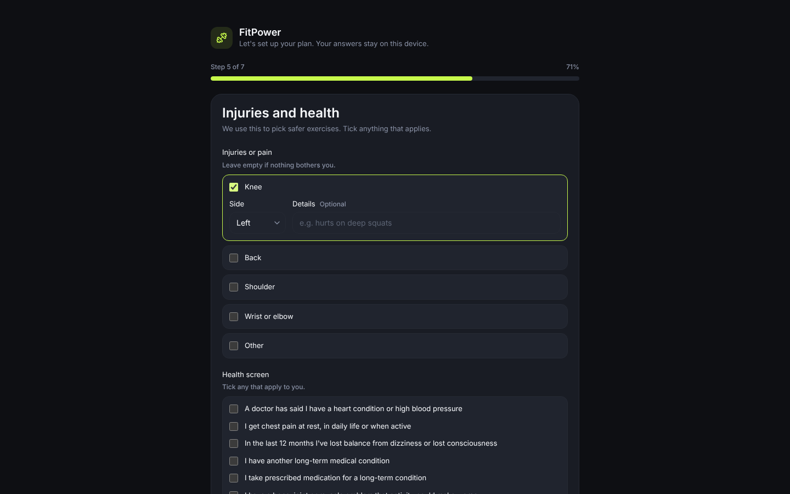
</p>

If you answer "yes" to a health-screen question, FitPower asks you to check with a doctor first.
You can redo the whole setup later from **Settings → Redo setup**; your logs are kept.

## Built-in plans (no AI needed)

From your answers, FitPower recommends a level and builds a plan that runs from tomorrow to
your target date:

| Level            | For                                                     | What changes                          |
| ---------------- | ------------------------------------------------------- | ------------------------------------- |
| **Easy**         | Starting out, coming back, or training around an injury | Fewer rounds, longer rests            |
| **Intermediate** | Some regular training behind you                        | The balanced program, steady progress |
| **Hard**         | Several years of consistent training                    | More rounds, shorter rests            |

Every plan uses full-body sessions on the days you said you can train, walks on the other days,
and phases that get harder as you go. Exercises are chosen for a dumbbell and a band, and if you
listed a knee, back, shoulder or wrist injury, moves that strain it are left out. You can switch
level any time on the **Plan** page.

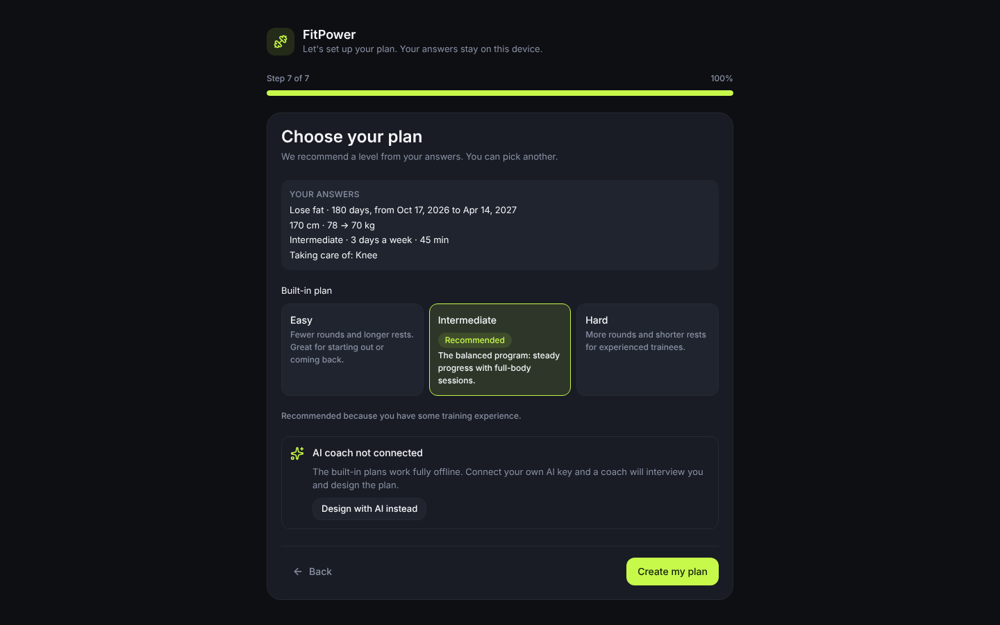

## Optional: the AI coach with your own key

FitPower works completely without AI. If you want a coach that talks the plan through with you,
connect your own API key on the **AI coach** page.

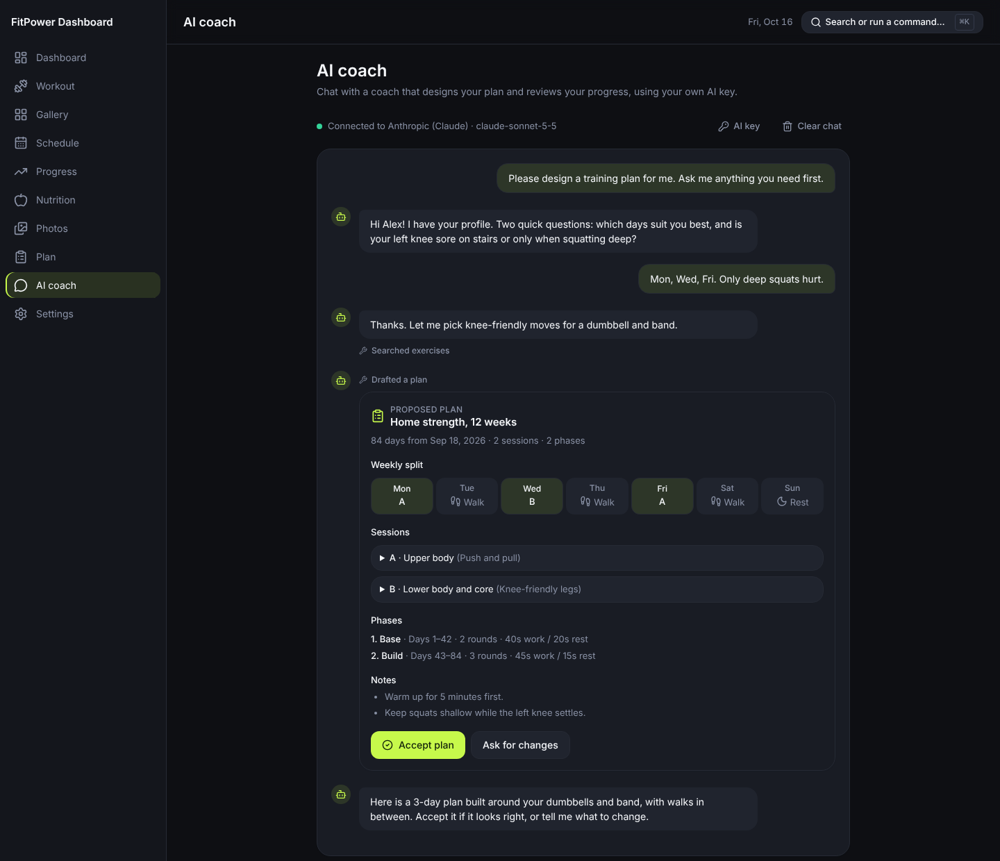

**What it does**

- Interviews you about your goal, schedule and any limits, and asks follow-up questions.
- Designs a plan from the exercise library and shows it as a card you can **accept** or ask to change.
  Nothing replaces your current plan until you accept.
- Later, answers questions about your progress, adjusts the plan, or suggests swaps. It stays on
  fitness and this app.

**Supported providers**

| Provider                                  | What you need                                                                                                              |
| ----------------------------------------- | -------------------------------------------------------------------------------------------------------------------------- |
| Anthropic (Claude)                        | An API key from [console.anthropic.com](https://console.anthropic.com)                                                     |
| OpenAI                                    | An API key from [platform.openai.com](https://platform.openai.com)                                                         |
| OpenAI-compatible, including local models | A base URL, for example Ollama (`http://localhost:11434/v1`) or LM Studio (`http://localhost:1234/v1`). A key is optional. |

Pick any model your key can use that supports tool calling. API usage is billed by your provider,
not by FitPower. A local model through Ollama or LM Studio keeps even the coach on your own
machine (in LM Studio, turn on CORS in the server settings).

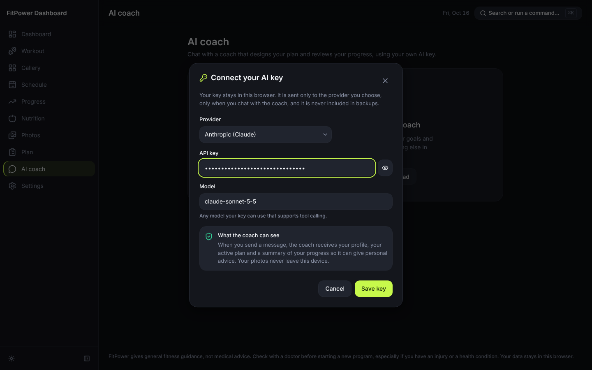

**Where your key goes**

- The key is saved only in this browser, in its own entry, separate from your fitness data.
  It is **never** written into backups.
- It is sent only to the provider you picked, and only while you are chatting with the coach.
  This is the only time FitPower uses the internet.
- When you send a message, the coach receives your profile, your active plan and a summary of
  your progress. Your photos never leave your device.

**Removing the key.** On the AI coach page, open **AI key → Remove key**. Your plan stays as it is.
**Settings → Reset everything** also removes the key and the chat history.

## Daily use

| Page          | What it is for                                                                                              |
| ------------- | ----------------------------------------------------------------------------------------------------------- |
| **Dashboard** | Today's workout, weight trend, streak, this week's sessions and today's targets                             |
| **Workout**   | Timer and exercise list for today's session; log sets, swap an exercise, rate the session, mark it complete |
| **Gallery**   | Browse exercises by muscle group, star favorites, see demo images, how-to steps and video links             |
| **Schedule**  | Every day of your plan at a glance: done, missed, rest and today                                            |
| **Progress**  | Log weight and waist, chest and hip measurements                                                            |
| **Nutrition** | Calories, protein, water and steps against your targets                                                     |
| **Photos**    | Progress photos, side-by-side comparison, download                                                          |
| **Plan**      | Your phases, weekly split and nutrition targets; switch plan level                                          |
| **AI coach**  | Chat with the coach (optional, needs a key)                                                                 |
| **Settings**  | Profile, theme, start date, backups, reset                                                                  |

Press **Ctrl+K** (or **⌘K** on a Mac) anywhere to jump to a page or run a command.

<p>
  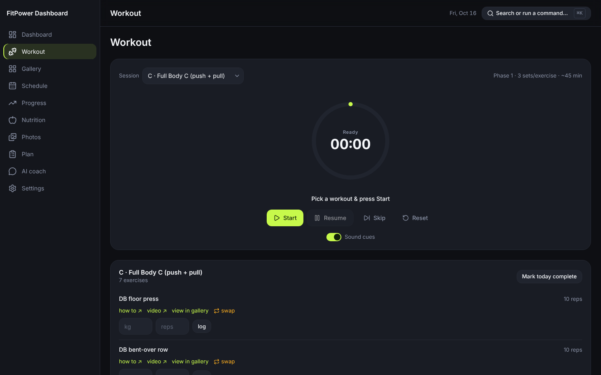
  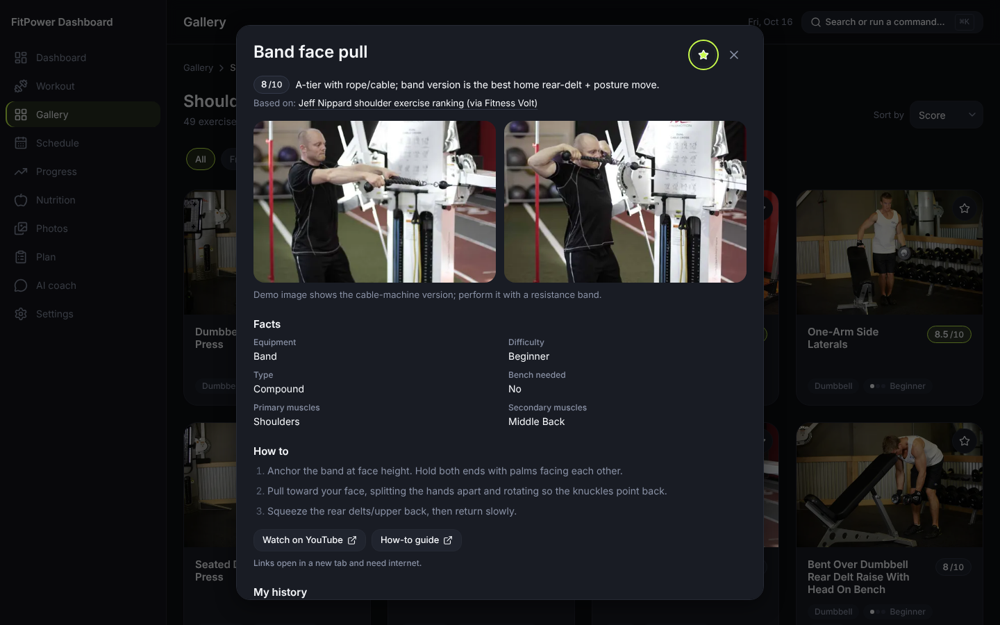
</p>
<p>
  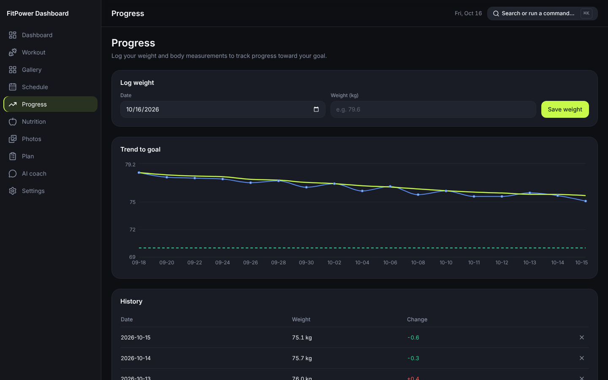
  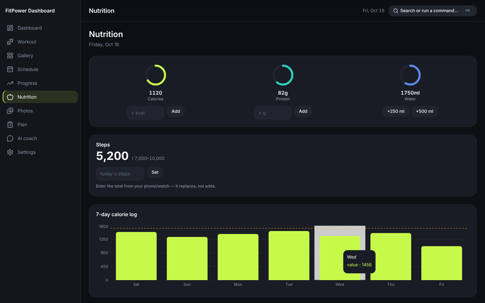
</p>
<p>
  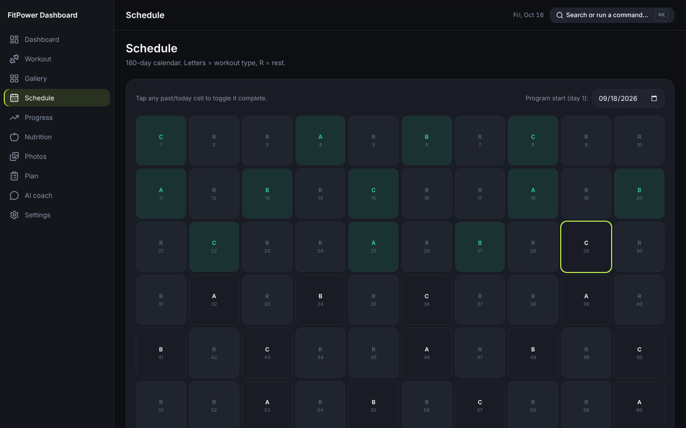
  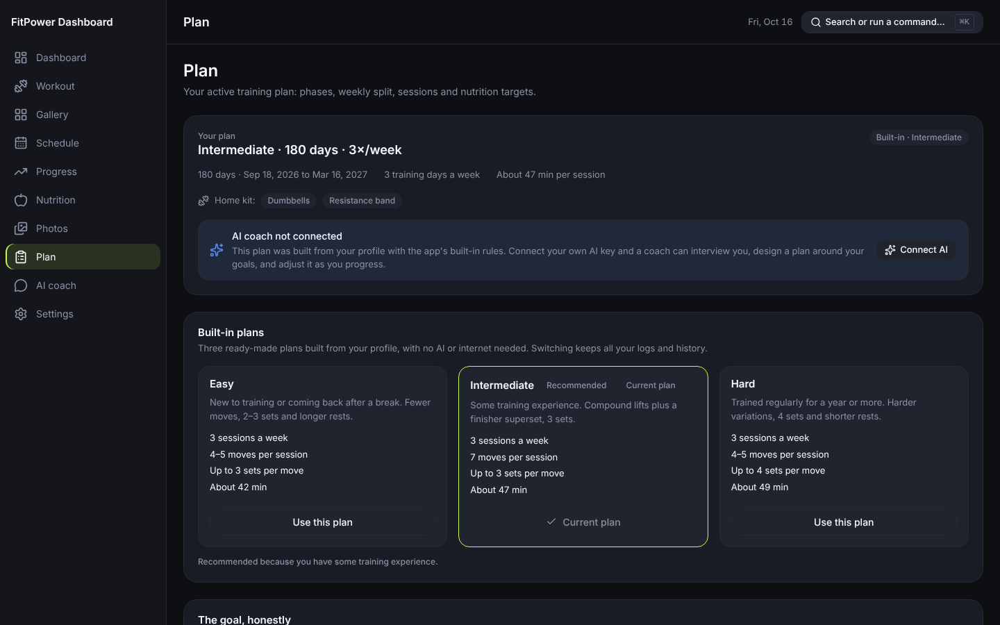
</p>

**Home workouts.** Every exercise in the Gallery uses a dumbbell, a resistance band, or your
body weight. Each one links to a how-to guide and a video demo (those links open in a new tab and
need the internet; everything else works offline). If a move does not suit you, **swap** offers
alternatives that work the same muscles.

**Light theme and phone.** Switch theme in **Settings → Appearance** or with the sun icon in the
sidebar. The layout adapts to a phone screen.

<p>
  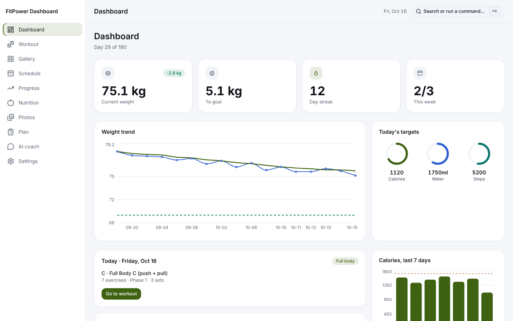
  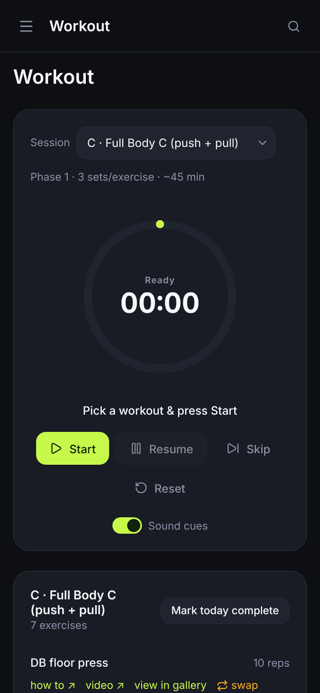
</p>

## Your data, privacy and backups

- **Everything stays in your browser** (localStorage, and IndexedDB for photos). No account, no
  server, no analytics or tracking.
- **The only network traffic** is the AI coach talking to the provider you chose, and video or
  how-to links you click yourself.
- **Data belongs to one browser at one address.** Another browser, another device, or a different
  port starts empty. Clearing your browser's site data deletes it.

**Back up regularly.** Go to **Settings → Backup → Export backup (JSON)** to save a file with your
profile, plan and all your logs. FitPower reminds you weekly. To restore, or to move to another
browser or computer, use **Import backup** there. Backups do not contain your AI key or your
photos; download photos you want to keep from the **Photos** page.

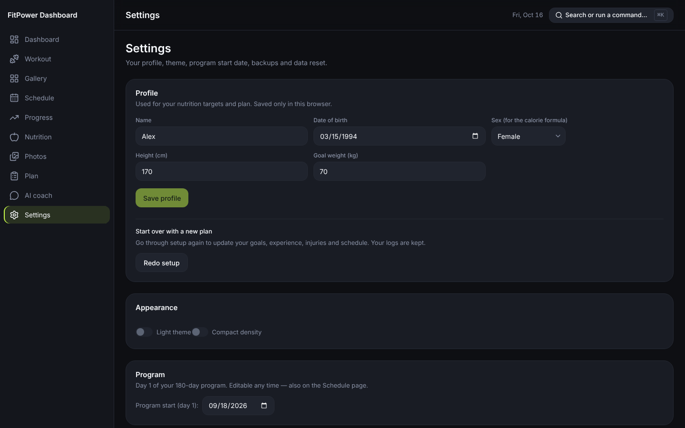

If you used the original single-file FitPower tracker (v1), its JSON export imports here too.

## For developers

FitPower is Vite + React 18 + TypeScript, Tailwind CSS, zustand, TanStack Query, react-i18next
and Recharts, tested with Vitest, Testing Library, jest-axe and Playwright. All storage sits
behind a repository layer so a backend could be added later without touching the UI.
[CLAUDE.md](./CLAUDE.md) describes the architecture and rules, and [DESIGN.md](./DESIGN.md) the
design system.

```bash
npm install              # install dependencies
npm start                # build and serve on http://localhost:5173 (holds your real data)
npm run dev              # dev server on http://localhost:5174 (separate, empty data)
npm run build            # typecheck + production build
npm run typecheck        # TypeScript project references, no emit
npm run lint             # ESLint (with jsx-a11y)
npm run format           # Prettier
npm run test             # unit and component tests (Vitest)
npm run test:e2e         # Playwright end-to-end tests, including axe and offline checks
npm run storybook        # component library on http://localhost:6006
npm run screenshots      # regenerate the README screenshots in docs/screenshots
```

`npm run dev` uses a different port on purpose, so development never touches the data in your
`npm start` copy. `npm run screenshots` drives a demo user through setup with scripted AI replies
(no real AI is called); see `e2e/screenshots/readme.shots.ts`.

**Workout Gallery content.** `src/content/exerciseCatalog.json` is generated by
`docs/gallery/catalog-build/build.py`; do not edit it by hand. Demo images live in
`public/exercises/` and are cached for offline use. Spec:
[docs/gallery/GALLERY_SPEC.md](./docs/gallery/GALLERY_SPEC.md).

Contributions are welcome. Please run `npm run typecheck`, `npm run lint` and `npm run test`
before opening a pull request.

## License

[MIT](./LICENSE)
